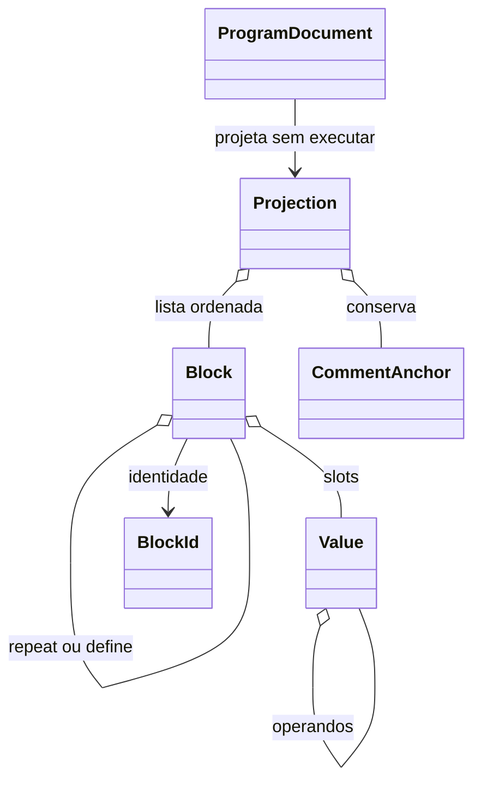

# Contratos de implementação

Especificação de 23/10/2026, materializada na T-062 em src/core/{common,program,turtle}, src/application e src/shared. Motor, conversor e backend continuam sendo implementações futuras destas fronteiras. Ajustes de implementação são permitidos se preservarem PRD e consumidores, com alteração coordenada da documentação.

## 1. Tipos do programa

```ts
declare const blockBrand: unique symbol;
export type BlockId = string & { readonly [blockBrand]: true };
export type RGB = readonly [number, number, number];
export type Span = Readonly<{ start: number; end: number }>;
export type Diagnostic = Readonly<{
  code: string;
  message: string;
  span?: Span;
}>;
export type Result<T> =
  | Readonly<{ ok: true; value: T }>
  | Readonly<{ ok: false; diagnostics: readonly Diagnostic[] }>;

export type Value =
  | Readonly<{ kind: 'number'; value: number }>
  | Readonly<{ kind: 'variable'; name: string }>
  | Readonly<{
      kind: 'operator';
      command: 'sum' | 'difference' | 'product' | 'divide';
      left: Value;
      right: Value;
    }>;
export type BlockMeta = Readonly<{ id: BlockId; sourceSpan?: Span }>;
export type Block = BlockMeta & (
  | Readonly<{
      kind: 'move';
      command: 'forward' | 'backward' | 'left' | 'right' | 'setx' | 'sety';
      value: Value;
    }>
  | Readonly<{ kind: 'position'; x: Value; y: Value }>
  | Readonly<{ kind: 'pen'; command: 'penup' | 'pendown' | 'reset' }>
  | Readonly<{ kind: 'color'; rgb: RGB }>
  | Readonly<{ kind: 'repeat'; times: Value; body: readonly Block[] }>
  | Readonly<{ kind: 'define'; name: string; body: readonly Block[] }>
  | Readonly<{ kind: 'call'; name: string }>
  | Readonly<{ kind: 'make'; name: string; value: Value }>
);

/** Contrato persistido: fonte canônica, sem HTML ou cache de blocos. */
export type ProgramDocument = Readonly<{
  formatVersion: 1;
  source: string;
  characterId: string;
}>;
export type CommentAnchor = Readonly<{
  text: string;
  span: Span;
  placement: 'leading' | 'trailing' | 'program';
  blockId?: BlockId;
}>;
export type Projection = Readonly<{
  sourceRevision: number;
  originalSource: string;
  blocks: readonly Block[];
  comments: readonly CommentAnchor[];
}>;
export type BodyTarget = Readonly<{ parentId: BlockId | null; index: number }>;
export type BlockAction =
  | Readonly<{ type: 'insert'; block: Block; target: BodyTarget }>
  | Readonly<{ type: 'move'; id: BlockId; target: BodyTarget }>
  | Readonly<{ type: 'remove'; id: BlockId }>
  | Readonly<{ type: 'replace'; id: BlockId; block: Block }>;

/** Não executa LOGO; retorna somente projeções integralmente representáveis. */
export declare function sourceToBlocks(source: string, revision: number): Result<Projection>;
/** Valida invariantes, aplica edição e preserva comentários ou falha sem mutação. */
export declare function editBlocks(projection: Projection, action: BlockAction): Result<Projection>;
/** Sem alterações na projeção, retorna originalSource exatamente. */
export declare function blocksToSource(projection: Projection): Result<string>;
```

`replace` exige conservar o ID do alvo; mudar espécie de bloco não é funcionalidade de UI exigida. Valores aninhados são imutáveis. IDs são criados por fábrica central e validados nas fronteiras, não com casts espalhados. `Span` usa offsets UTF-16 semiabertos, compatíveis com editor; renderização calcula linha/coluna. Parser conserva posições e comentários para a projeção, sem prometer uma gramática nova de LOGO.

Operadores da paleta criam expressões arrastáveis para slots; não precisam ser novas instruções de programa. Se houver operador raiz nos CP7 reais, caracterizar antes de decidir sua importação. Nome de variável/procedimento segue gramática atual; parâmetros de procedimentos permanecem CLI. Definir/chamar são parte das 19 opções visuais, sem expor todos os 80 comandos em blocos.



## 2. Fronteiras de aplicação

```ts
export type RunStatus = 'idle' | 'running' | 'error';
export type Speed = 'slow' | 'normal' | 'fast';
export type Point = Readonly<{ x: number; y: number }>;
export type DrawOp =
  | Readonly<{ kind: 'line'; from: Point; to: Point; width: number; color: RGB }>
  | Readonly<{ kind: 'arc'; center: Point; radius: number; start: number; end: number; width: number; color: RGB }>
  | Readonly<{ kind: 'clear' }>;
export type TurtleView = Readonly<{
  position: Point;
  heading: number;
  visible: boolean;
}>;
export type RunEvent =
  | Readonly<{ type: 'state'; status: RunStatus }>
  | Readonly<{ type: 'text'; text: string }>
  | Readonly<{ type: 'clear-text' }>
  | Readonly<{ type: 'draw'; operations: readonly DrawOp[]; turtle: TurtleView }>
  | Readonly<{ type: 'error'; diagnostic: Diagnostic }>;
export interface Runner {
  /** Executa a fonte, preservando a semântica de sessão caracterizada. */
  start(source: string, speed: Speed): Result<void>;
  /** Cancela execução e desenho pendentes; nunca apaga a fonte. */
  stop(): void;
  /** Reinicia ambiente, tartaruga, tinta e saída, preservando a fonte externa. */
  clear(): void;
  /** Muda somente agendamento, sem reiniciar sessão ou modificar geometria. */
  setSpeed(speed: Speed): void;
  /** Observa eventos ordenados; devolve uma função de desinscrição. */
  subscribe(listener: (event: RunEvent) => void): () => void;
  /** Libera agendamentos e assinaturas. */
  dispose(): void;
}
export interface Renderer {
  /** Aplica operações sem armazenar estado de negócio em React. */
  apply(operations: readonly DrawOp[], turtle: TurtleView): void;
  /** Redesenha o log nas mesmas coordenadas lógicas. */
  resize(width: number, height: number, pixelRatio: number): void;
  /** Exporta apenas a imagem do palco, sem elementos da interface. */
  exportPng(): Promise<Blob>;
  /** Desconecta observadores e libera recursos. */
  dispose(): void;
}
export type ShareSummary = Readonly<{ id: string; createdAt: string; previewUrl: string }>;
export type ShareEntry = ShareSummary & Readonly<{ program: ProgramDocument }>;
export type SharePage = Readonly<{ items: readonly ShareSummary[]; nextCursor: string | null }>;
export interface ShareStore {
  /** Cria um compartilhado novo e imutável. */
  create(program: ProgramDocument, png: Blob): Promise<Result<ShareEntry>>;
  /** Lê uma página de resumos sem carregar todos os programas. */
  list(cursor?: string): Promise<Result<SharePage>>;
  /** Carrega documento validado para abertura pelo cliente. */
  load(id: string): Promise<Result<ShareEntry>>;
}
```

Renderer mantém log/último estado fora do reducer. Runner não conhece React, filesystem ou HTTP. ShareStore do frontend é adaptador HTTP; repositório de arquivos é interface separada do servidor. Fakes são objetos que implementam as mesmas portas, sem container de injeção. Preferências e catálogo de personagens são módulos pequenos; criar interface apenas se testes/IO justificarem.

Reducer: `sourceChanged`, `switchModeRequested`, `blockActionRequested`, `characterChanged`, `speedChanged`, `selectionChanged`, `runStateChanged`, `dialogChanged`. Parsing, execução, conversão e salvamento ficam em ações/serviços fora do reducer. Seletores retornam modo, fonte atual, projeção válida, seleção e controles habilitados. Histórico é limitado a 100 entradas; saída de texto ao limite da arquitetura.

## 3. HTTP v1

| Método/rota | Entrada | Resposta |
|---|---|---|
| POST `/api/v1/shares` | `{program: ProgramDocument, pngBase64: string}` | 201 `{data: ShareEntry}`; `Location` do recurso |
| GET `/api/v1/shares?cursor=...&limit=...` | cursor opaco, limit 1–50 (padrão 20) | 200 `{data: SharePage}` |
| GET `/api/v1/shares/:id` | UUID válido | 200 `{data: ShareEntry}` |
| GET `/api/v1/shares/:id/preview.png` | UUID válido | PNG reencodado, tipo fixo, `nosniff` |
| GET `/api/health` | nenhuma | 200 `{status:"ok"}`, sem detalhes internos |

Erro JSON: `{error:{code:string,message:string}}`; mensagens legíveis em pt-BR, sem stack/path interno. Códigos HTTP: 400 dados/ID/cursor inválidos; 404 inexistente; 413 tamanho; 415 tipo; 422 PNG/documento inválido; 429 frequência; 503 quota/armazenamento indisponível; 500 falha inesperada. Método não permitido retorna 405. Listagem nunca revela diretórios, arquivos temporários ou caminhos físicos.

Limites iniciais: corpo JSON até 3 MiB; PNG decodificado até 2 MiB e 2048×2048; fonte UTF-8 até 20 KiB; personagem da allowlist; propriedades desconhecidas rejeitadas. Valores finitos, strings limitadas e formato conhecido. LOGO sintaticamente inválido pode ser salvo como texto (rascunho); backend não o executa. Cliente avisa ao abrir/rodar.

Escrita: inicialmente 5 POST/minuto por IP, com limite global de concorrência 2 para imagens; ajustar justificadamente se uso de escola por NAT exigir. Leitura paginada. Quota de dados configurável (referência 250 MiB; confirmar espaço/backup antes do deploy), sem apagar obras antigas para liberar espaço automaticamente. Tamanhos são verificados antes e após decodificação; prevenir bombas de imagem.

Request body limitado também no proxy. Origem pública configurada; CORS same-origin; sem cookies/credentials ou execução de URLs remotas. DELETE/PUT/PATCH públicos não existem. Administrador remove por UUID via comando local e mantém backup conforme política de operação.

## 4. Aceites de conversão

1. Quadrado com `repeat`, aliases `fw/rt`, números e operadores suportados: ida/volta semanticamente equivalente.
2. Alternar sem editar: fonte idêntica, incluindo espaços/comentários.
3. Mover/editar bloco: comentário preservado; precedência de expressão mantida.
4. `random`, condicionais, procedimento com parâmetros ou sintaxe incompleta: diagnóstico e CLI intacta.
5. Falha durante edição visual: fonte e projeção anteriores intactas, sem estado intermediário salvo.
6. Programa carregado por API segue exatamente a mesma análise, sem confiar em conteúdo por vir do próprio servidor.
7. Importação dos 34 CP7 conserva conteúdo original e produz relatório de equivalência com TXT; HTML malicioso não é executado nem copiado para a interface.

## Materialização na T-062

`core/common` expõe Result/Diagnostic/Span/RGB e helpers `succeed`/`fail` (falha exige pelo menos um diagnóstico). `core/program` expõe tipos e fábrica `createBlockId(unknown): Result<BlockId>`: 1–128 caracteres ASCII alfanuméricos/hífen/sublinhado, iniciando com alfanumérico, sem normalização. IDs não são gerados aleatoriamente no core; unicidade/parentesco serão validados pelo editor.

As três assinaturas de conversão acima formam a interface `ConversionService`; nenhuma função vazia ou conversão parcial é publicada na fundação. Portas de aplicação estão em application/index.ts. Schemas Zod em shared/index.ts validam envelope estrito, UTF-8 (não número de caracteres), 21 personagens, UUID/página/limites e vínculo da URL relativa de prévia ao mesmo UUID. Validação estrutural de base64 não afirma que o conteúdo é PNG válido: essa validação e reencode são obrigação da T-065.


A integração T-063/T-066 acrescenta `Runner.clear()` e `Runner.setSpeed()` como operações explícitas. Limpar coordena cancelamento e reinício dentro do dono da sessão, evitando que UI limpe apenas o canvas e deixe variáveis antigas. Velocidade atua no agendamento, sem reconstruir tartaruga. O documento fonte não pertence ao runner.


`BodyTarget.index` identifica um encaixe entre irmãos na árvore **anterior à remoção**. Há length+1 encaixes; mover um item para índice posterior no mesmo corpo desconta a remoção uma única vez. A UI pode usar o mesmo destino para inserir ou mover; conversor valida e ajusta atomicamente, sem depender de DOM.
