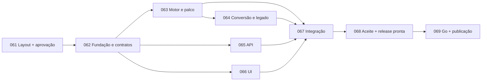

# Plano de entrega e fila

Atualizado em 23/10/2026. T-061 concluída: v6 aprovada por Márcio e integrada pelo PR #5 (`e7038fb`). T-062 integrada pelo PR #6 (`bea82feb`), CI Linux40058083365 aprovada. T-065 integrada pelo PR #7 (`ba3893df`), CI40058997348 aprovada. T-063 e T-066 em andamento em escopos separados. Fila: `/Users/marciopassos/dev/instadev/tasks/queue`. Regras específicas: [PINTEO7.md](../../tasks/PINTEO7.md). Numeração compartilhada desta rodada: T-061–T-069.

## Sequência

| Task | Entrega | Depende de | Situação inicial |
|---|---|---|---|
| T-061 | Protótipo de layout/UX com mocks e decisão de Márcio | nenhuma | done — PR #5 / e7038fb |
| T-062 | Fundação, contratos, caracterização e CI | T-061 | done — PR #6 / bea82feb |
| T-063 | Papert tipado, tartaruga, canvas e runner seguro | T-062 | in-progress — motor e palco |
| T-064 | Conversão bidirecional e importação dos 34 exemplos | T-063 | aguardando parser estável |
| T-065 | API Node e compartilhamento seguro em arquivos | T-062 | done — PR #7 / ba3893df |
| T-066 | Interface React, blocos e editor conforme protótipo | T-062 | in-progress — UI conforme v6 |
| T-067 | Integração funcional e retirada do legado do artefato | T-063, T-064, T-065, T-066 | aguardando quatro frentes |
| T-068 | Aceite final local, documentação e release preparada | T-067 | aguardando integração |
| T-069 | Publicação e validação externa, após go específico | T-068 | exige autorização de produção |

Cada task é autocontida no arquivo da fila. Elegível significa predecessoras em done e resultado integrado/disponível na base. Não iniciar só por estar em queue; não mover tasks de outro projeto.

## Layout primeiro

T-061 usa HTML/CSS/JS local, assets existentes e dados fictícios; não instala stack nem conecta motor/API. Uma proposta rápida para visualizar áreas, proporções, paleta, blocos, palco, controles, galeria, personagem, ajuda e feedback. Referência: 45–60 minutos para primeira apresentação, não limite que prejudique acessibilidade básica. Não programar conversor/interpretador para validar layout.

Registrar em `docs/LAYOUT.md` versão/capturas aprovadas, data e ajustes de Márcio. Não inventar aprovação nem marcar done só por gerar screenshot. Enquanto aguarda, T-061 fica in-progress; produto não avança. Protótipo é estudo descartável e não determina arquitetura por acidente.

## Coordenação e revisão

Depois de T-062, motor, API e UI podem ter agentes distintos; conversão depende do parser. Coordenador cuida de contratos, lockfile, CI e fila; agentes têm propriedade de arquivos distinta. Subagentes da sessão, sem criar chats do usuário. No máximo três implementadores simultâneos além do coordenador, respeitando limites disponíveis. Worktrees opcionais conforme workspace.

Uma revisão técnica por lote; repetir apenas partes afetadas por correção ou risco concreto. Segurança, perda de dados, regressão e contrato quebrado bloqueiam; gosto cosmético não gera ciclos indefinidos. Testes proporcionais, sem metas artificiais de cobertura. Não excluir checks para concluir mais rápido.

## Migração e evidência

T-062 preserva hashes/originais e cria fixtures reais com motor legado isolado e timeout efetivo (um timeout de teste sozinho não interrompe loop síncrono). T-063 compara o porte com essa referência e separa execução cooperativa. T-064 valida conversão/importação; T-065 rotas e disco; T-066 UI com fakes. T-067 integra, adiciona E2E reais e remove legado do artefato. T-068 verifica release limpa; não refaz pesquisas sem mudança.

Módulos novos convivem temporariamente com entrada legada local; um produto final. Não mover árvore inteira para public, expor PHP/CP7 ou deixar salvar falhando como comportamento aceito. Caracterizar bugs e registrar correções intencionais. Testes e CI crescem conforme artefatos existem, sem testes de fachada.

## Git e autorizações

Esta rodada autoriza somente docs/fila/prompt. Documentos ficam inicialmente como alterações locais na main; preservar/incorporar à base antes de delegar worktrees. Não resetar nem partir de origin/main sem o planejamento. A pesquisa #2 foi entregue no PR #3; arquitetura/contratos/convenções respondem à issue #4, mas ela não foi fechada nesta rodada.

O prompt de retomada propõe autorização para trabalho local, commits, push, PRs e merges técnicos após aprovação visual. Essa autorização só vale quando enviado pelo usuário; um arquivo não se autoautoriza. Publicação exige go específico com pacote revisável da T-068. Reusar autorização já dada, sem perguntar a cada operação rotineira.

PR curto por entrega; task pode ter poucos PRs para separar risco. Done exige critérios e resultado acessível às dependentes; registrar SHA/PR de integração. PR aberto não é mudança integrada. Não usar oito horas como motivo para reduzir segurança ou paridade.

## Produção e conclusão

T-068 prepara artefato, lista publicável, configuração/serviço, migração, backup e rollback localmente. T-069 após go reconfirma SSH, host, configuração e capacidade; cria usuário restrito se necessário, publica subdomínio e valida externamente sem afetar instadev.com.br. Sem banco novo. Dados ficam separados de releases; rollback não apaga obras novas.

Estado de produção de 22/10 é histórico, não confirmação atual. Divergência material pede ajuste concreto; nunca aplicar configuração cega ou usar falta de acesso como evidência de sucesso. Meta completa apenas com publicação validada; antes disso registrar `pronto para publicar`. Prompt: [PROMPT-NOVA-SESSAO.md](PROMPT-NOVA-SESSAO.md).
